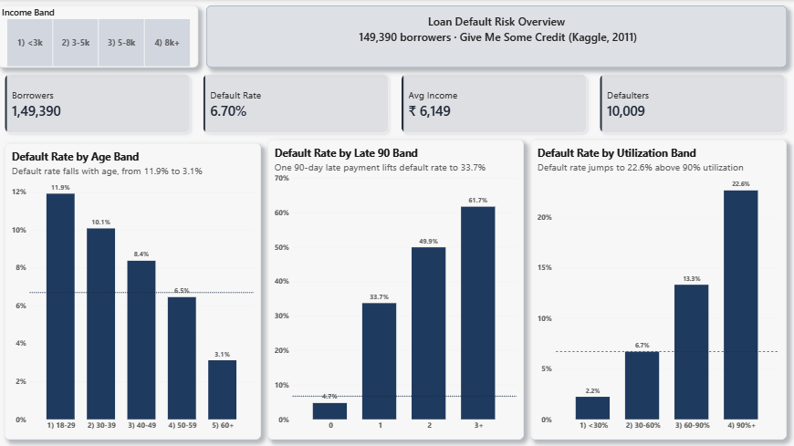
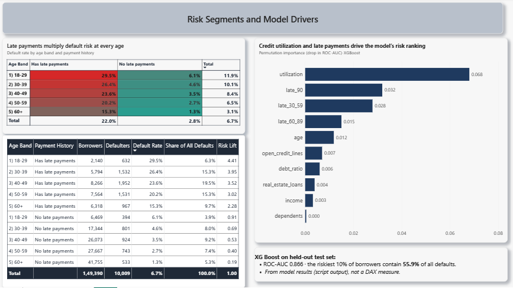

# Loan Default Risk Analysis

SQL, Python and Power BI analysis of ~150K borrowers from the public *Give Me Some Credit* dataset: which borrower groups default most, how strongly late payments and credit utilization signal risk, and how well a classification model can rank borrowers by risk.

**Tools:** Python (Pandas, SciPy, scikit-learn, XGBoost) · SQL (SQLite: CTEs, window functions) · Power BI (DAX)




---

## Key findings

Overall default rate (serious delinquency within 2 years): **6.70%** (10,009 of 149,390 borrowers).

| Signal | Lowest-risk group | Highest-risk group |
|---|---|---|
| Credit utilization | < 30% used: **2.23%** | 90%+ used: **22.61%** |
| Times 90+ days late | Never: **4.73%** | 4 or more times: **66.06%** |
| Age | 60+: **3.12%** | 18–29: **11.92%** |
| Monthly income | 8k+: **4.64%** | under 3k: **9.06%** |

- **Late-payment history is the strongest warning sign.** Borrowers with any 90+ day late payment defaulted at 41.3% vs 4.7% for those who were never that late.
- **A fifth of borrowers account for two thirds of defaults.** Borrowers with any late payment are 20.1% of the portfolio but 66.1% of all defaults.
- **Utilization and income together:** borrowers using 90%+ of their credit with a 3–5k monthly income default at **3.83×** the overall rate.
- **Highest-risk segment:** ages 18–29 with late payments, at 29.5% default. **Lowest:** ages 60+ with no late payments, at 1.28%.
- **Dependents matter less:** the default rate rises only from 5.83% (0 dependents) to 10.28% (4 or more).

## Statistical tests

Defaulters differ from non-defaulters on every variable tested (Mann-Whitney U for numeric variables, chi-square for late payments). With ~150K rows, p-values are tiny, so the size of the difference matters more:

| Variable | Defaulters (median) | Non-defaulters (median) |
|---|---|---|
| Credit utilization | 0.84 | 0.13 |
| Age | 45 | 52 |
| Debt ratio | 0.43 | 0.36 |
| Monthly income (reported only, n = 120,169) | 4,500 | 5,475 |

Income is compared only for borrowers who reported it, because ~20% of incomes were imputed with the median and would hide the real gap.

## Model

Task: predict default (about 6.7% of borrowers, so heavily imbalanced). Stratified 80/20 train/test split (29,878 test borrowers, 2,002 of them defaulters). Both models use class weighting. Accuracy is not reported as a headline because predicting "no default" for everyone already scores about 93%.

| Metric (test set) | Logistic Regression | XGBoost |
|---|---|---|
| ROC-AUC | 0.858 | 0.866 |
| PR-AUC (random guess ≈ 0.067) | 0.393 | 0.410 |
| Share of all defaulters in the riskiest 10% of borrowers | 54.1% | 55.9% |
| Recall for defaults (threshold 0.5) | 75.5% | 78.2% |
| Precision for defaults (threshold 0.5) | 21.5% | 21.6% |

- XGBoost is only slightly better than the simple logistic regression, which is useful to know: a simple model is already close.
- The model flags many safe borrowers to catch most defaulters (precision about 22%). In practice the threshold would be set by the cost of a missed default vs a rejected good borrower.
- **Top drivers** (permutation importance, drop in ROC-AUC): credit utilization (0.068), 90+ day lates (0.032), 30–59 day lates (0.028), 60–89 day lates (0.015), age (0.012).

## Data cleaning decisions

Source: Kaggle, *Give Me Some Credit* 2011 competition data (`cs-training.csv`, 150,000 rows). Every step is written to `outputs/cleaning_log.txt`.

| Issue | Rows | Decision |
|---|---|---|
| Duplicate rows | 609 | Dropped |
| Age under 18 | 1 | Dropped (not a valid borrower) |
| Placeholder codes 96/98 in the three late-payment columns | 225 each | Treated as missing, filled with the median (0) |
| Missing monthly income | 29,221 (after de-duplication) | Added an `income_missing` flag, filled with the median |
| Missing dependents | 3,924 | Filled with the median |
| Extreme utilization, debt ratio, income | 1,494 each | Capped at the 99th percentile |

Rows after cleaning: **149,390**.

## SQL analysis

Eight queries in `loan_default_analysis.py` (results saved as `outputs/q01…q08.csv`): default rate by age, income, utilization, 90-day lates and dependents; a CTE with `RANK()` and `SUM() OVER ()` to rank risk segments and show each segment's share of all defaults; and a CTE that calculates each segment's lift over the overall default rate.

## Power BI dashboard

Two pages built on `loans_clean.csv` with 7 DAX measures (Borrowers, Defaulters, Default Rate, Avg Income, Overall Default Rate, Risk Lift, Share of All Defaults) and 5 calculated band columns.

1. **Overview:** KPI cards, default rate by age band, credit utilization and 90-day lates, income-band slicer.
2. **Risk segments:** age × payment-history matrix with default rate, lift and share of defaults, plus model feature importance.

## Limitations

- Public 2011 data from one competition, so these results describe this dataset, not any specific lender's portfolio.
- Random train/test split, no time dimension, so real-world performance over time is untested.
- Median imputation and capping are simple choices that can affect results; income in particular is a weaker signal than it first appears because of the imputed values.
- No hyperparameter tuning, and the 0.5 decision threshold was not optimised.
- `SeriousDlqin2yrs` means 90+ days past due within 2 years; late-payment variables describe earlier behaviour, but I did not verify the exact timing in the data.

## How to run

```bash
pip install pandas numpy scipy scikit-learn xgboost
python loan_default_analysis.py cs-training.csv
```

Download `cs-training.csv` from Kaggle (*Give Me Some Credit*). The script creates an `outputs/` folder with the cleaned data, SQLite database, query results, test results and model metrics.

## Repository contents

```
loan_default_analysis.py     full pipeline: clean, SQL, tests, model
outputs/                     cleaning log, SQL results, stats, model metrics, loans_clean.csv
Loan-Default-Risk-Dashboard.pbix
images/                      dashboard screenshots
```
